# DigiHubPH

A digital content storefront where Filipino customers buy and download movies, music, and videos using **GCash, Maya, card, and QR Ph**.

**Live demo:** [digihubph.vercel.app](https://digihubph.vercel.app/)
**Author:** Filomeno Santiago Espiritu ([@flodigimovies](https://github.com/flodigimovies))

## Screenshots

<table>
  <tr>
    <td align="center">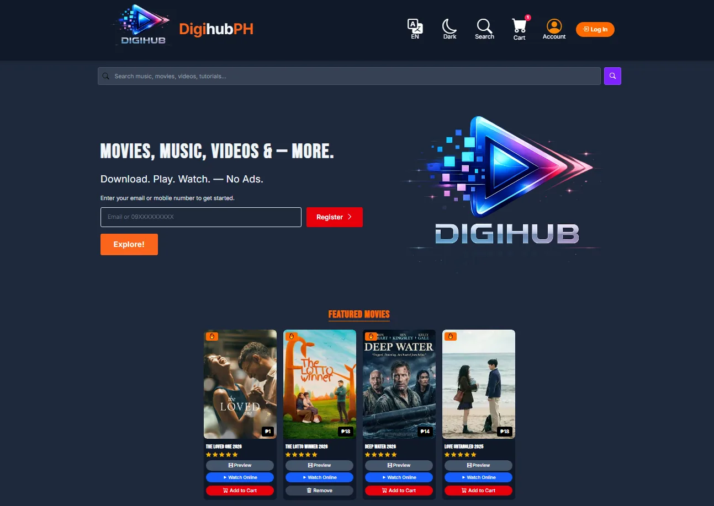<br /><sub>Home</sub></td>
    <td align="center">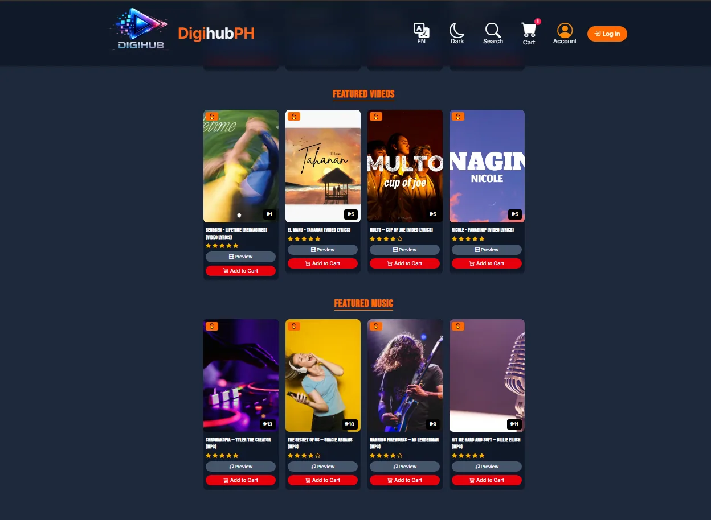<br /><sub>Featured</sub></td>
  </tr>
  <tr>
    <td align="center">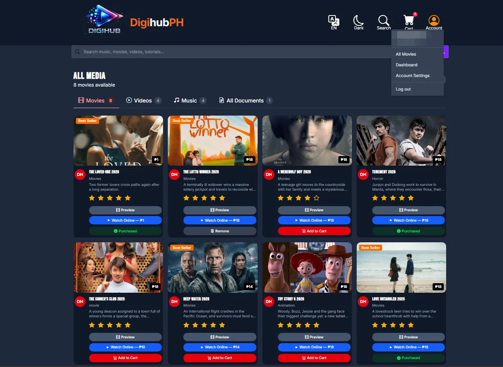<br /><sub>Movies catalog</sub></td>
    <td align="center">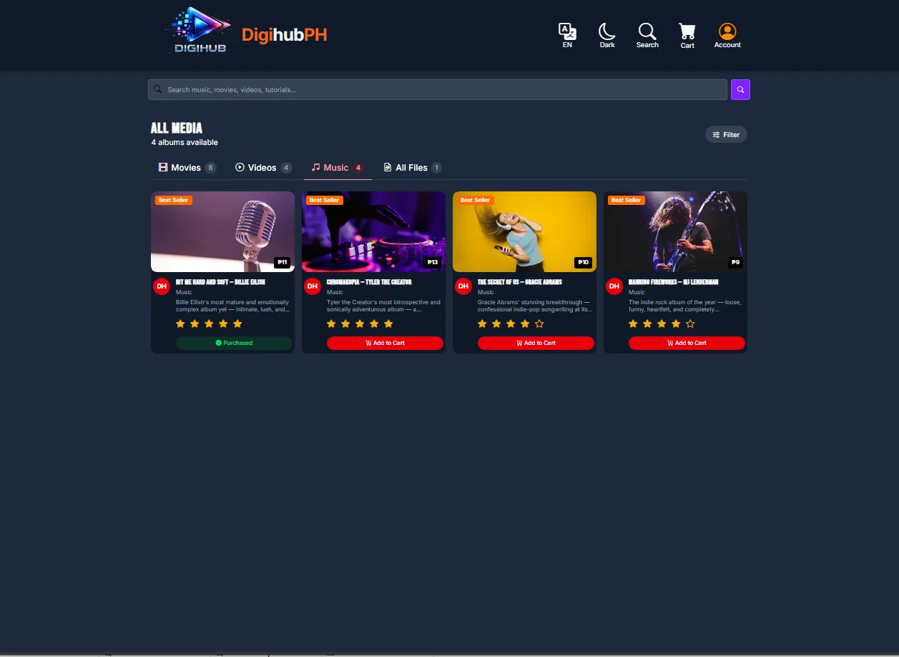<br /><sub>Music catalog</sub></td>
  </tr>
  <tr>
    <td align="center">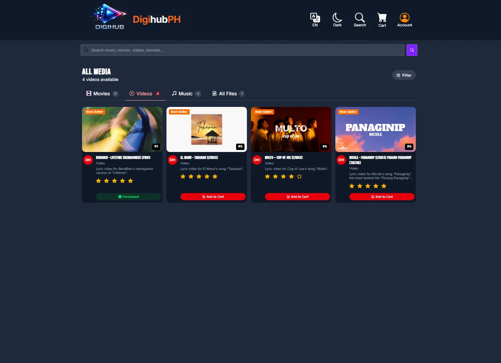<br /><sub>Videos catalog</sub></td>
    <td align="center">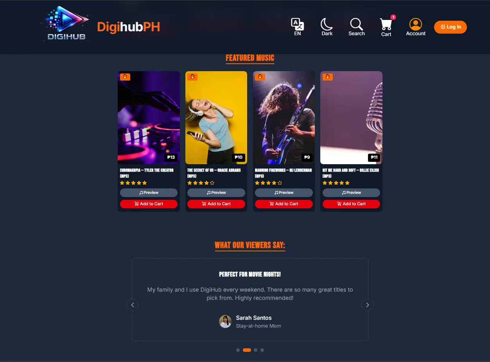<br /><sub>Reviews</sub></td>
  </tr>
  <tr>
    <td align="center">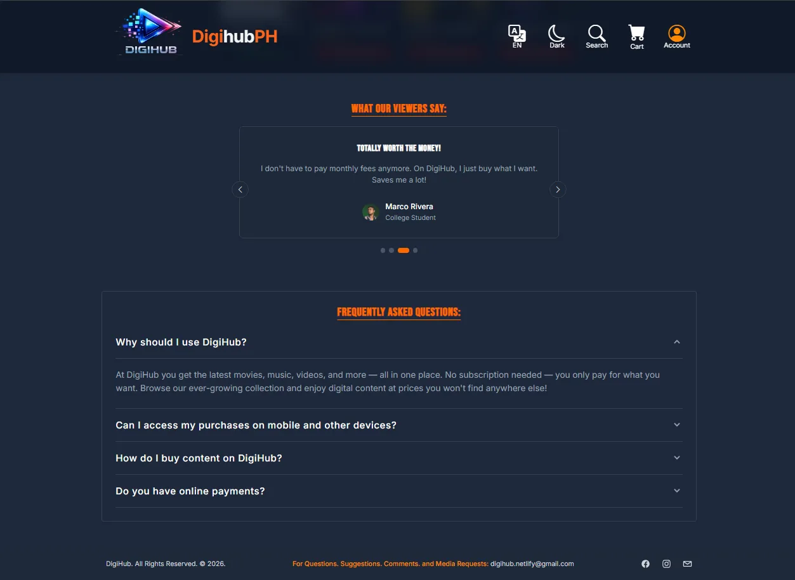<br /><sub>Reviews and FAQ</sub></td>
    <td align="center">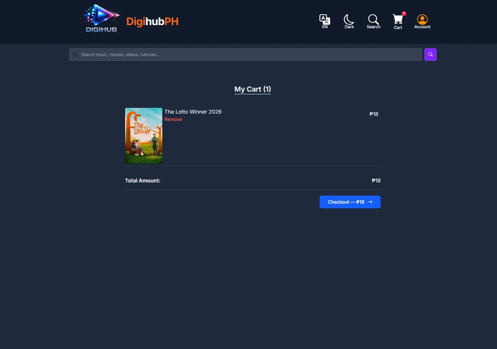<br /><sub>Cart</sub></td>
  </tr>
  <tr>
    <td align="center">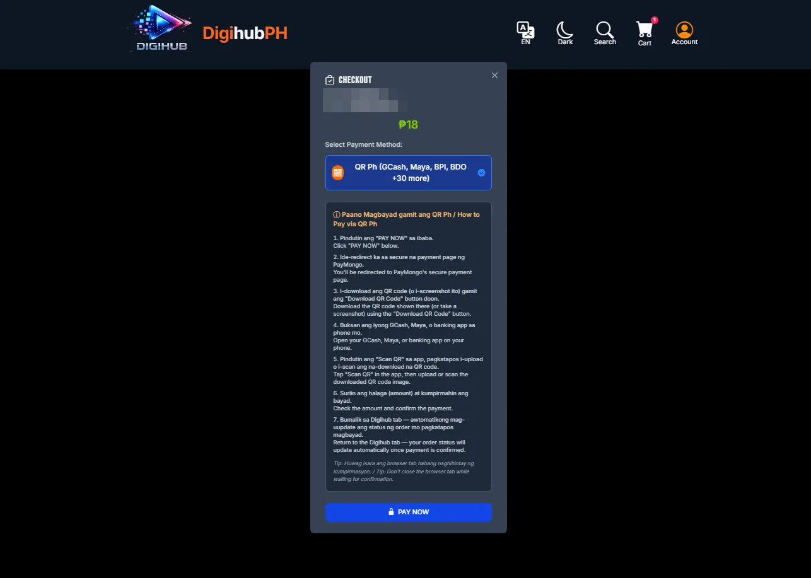<br /><sub>Checkout (bilingual QR Ph guide)</sub></td>
    <td align="center">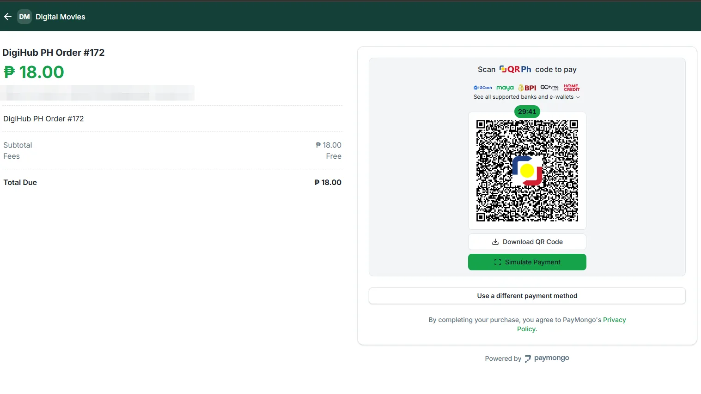<br /><sub>QR Ph payment (PayMongo test mode)</sub></td>
  </tr>
  <tr>
    <td align="center">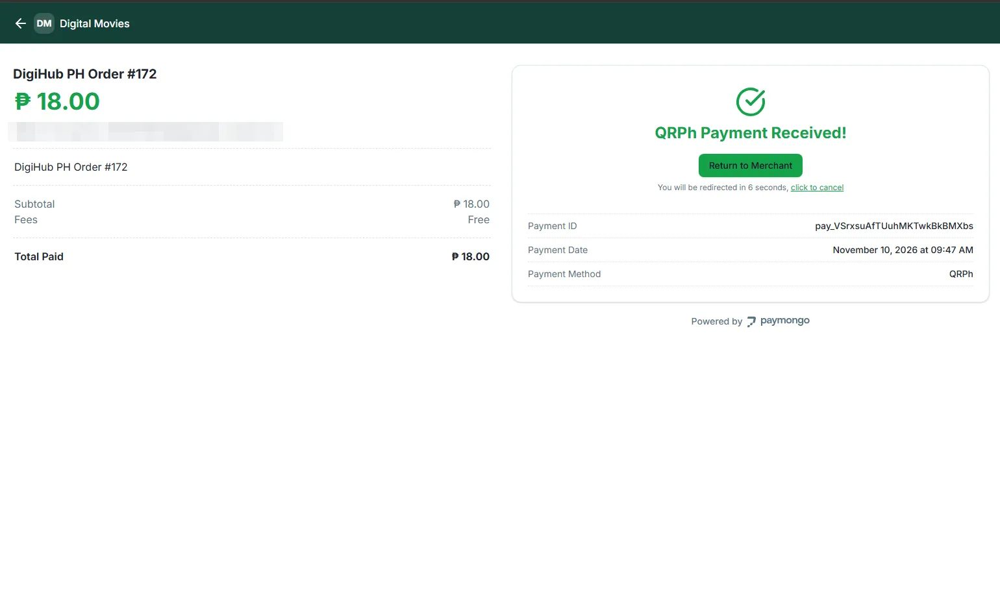<br /><sub>Payment received</sub></td>
    <td align="center">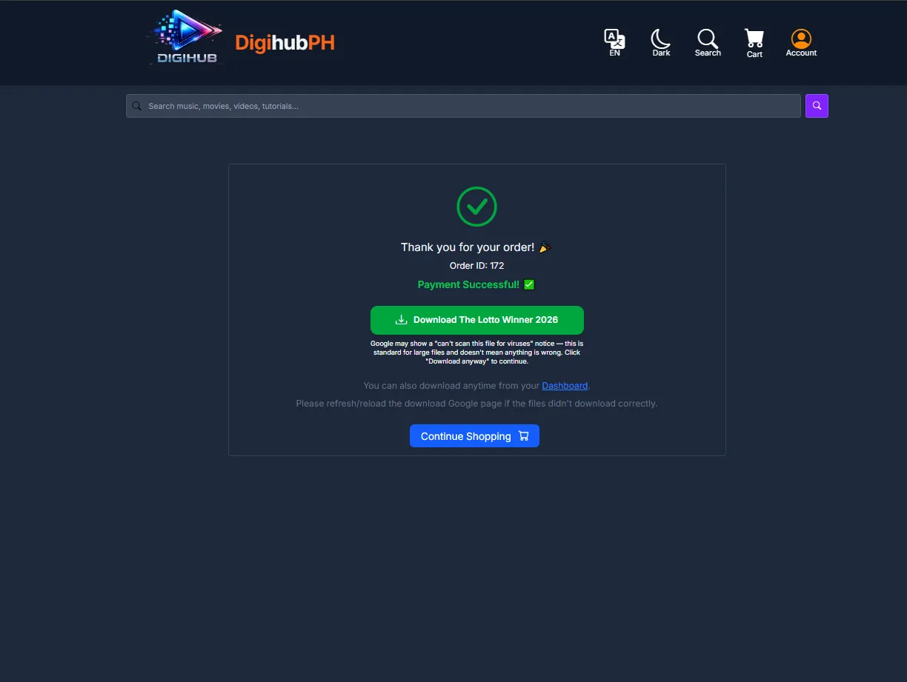<br /><sub>Order success and downloads</sub></td>
  </tr>
  <tr>
    <td align="center" colspan="2">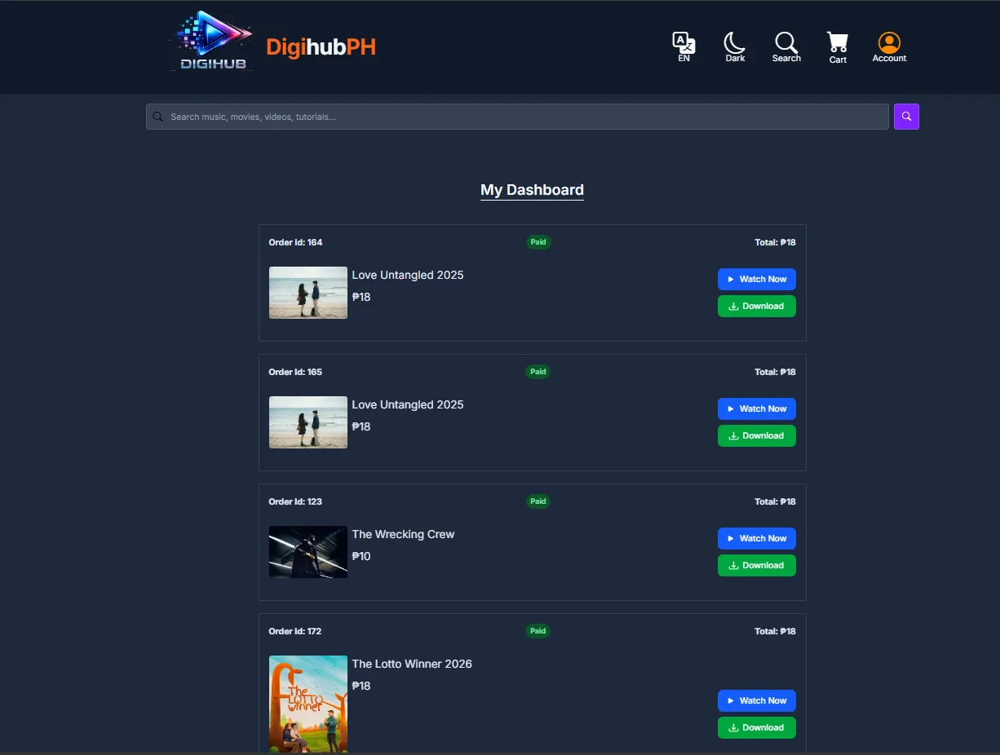<br /><sub>Dashboard</sub></td>
  </tr>
</table>

## Features

- Movies, music, and video catalog with search and filters
- Product pages with screenshot carousel, trailer preview, and ratings
- Video player for YouTube, Vimeo, Google Drive, and direct file links
- Persistent cart and checkout via PayMongo (GCash, Maya, card, QR Ph)
- Downloads unlock only after payment is confirmed
- Dashboard of purchased content with "Watch Now"
- Supabase auth (email and phone), protected routes, account deletion
<!-- - Guest demo login (guests cannot check out) -->
- English and Tagalog UI, dark and light mode, mobile-first layout

## Tech Stack

| Layer | Tech |
|---|---|
| Frontend | React 19, Vite, React Router 7, Tailwind CSS 4 |
| Backend | Supabase (Postgres, Auth, Edge Functions) |
| Payments | PayMongo, called from Supabase Edge Functions |
| Media | Cloudinary, Google Drive |
| Hosting | Vercel |

## How Payments Work

```
React app ──► paymongo-payment (Edge Function) ──► PayMongo
PayMongo ──(signed webhook)──► paymongo-webhook ──► marks order paid
```

The PayMongo secret key lives only in the Edge Functions, never in the browser. Orders are marked paid only by the verified webhook, never by the client.

## Getting Started

**Requirements:** Node.js 18+, a Supabase project (`products` and `orders` tables, Edge Functions deployed), and PayMongo test keys.

```bash
git clone https://github.com/<your-username>/digihubph.git
cd digihubph
npm install
```

Create a `.env` file in the project root:

```env
VITE_SUPABASE_URL=your_supabase_project_url
VITE_SUPABASE_ANON_KEY=your_supabase_anon_key
VITE_GUEST_LOGIN=guest_account_email   # optional
```

Never put secret keys in `VITE_` variables, since they can end up in the browser bundle. Store PayMongo secrets in Supabase instead, then deploy the functions:

```bash
supabase secrets set PAYMONGO_SECRET_KEY=your_paymongo_secret_key
supabase secrets set PAYMONGO_WEBHOOK_SECRET=your_paymongo_webhook_signing_secret

supabase functions deploy paymongo-payment
supabase functions deploy paymongo-webhook --no-verify-jwt
supabase functions deploy delete-account
```

### PayMongo webhook


<!-- The webhook skips JWT verification because PayMongo can't send auth headers. It verifies PayMongo's signature instead. In the PayMongo Dashboard (**Developers → Webhooks**), point a webhook at `https://<project-ref>.supabase.co/functions/v1/paymongo-webhook` and subscribe to `checkout_session.payment.paid`. -->

In the PayMongo Dashboard (Developers → Webhooks), point a webhook at
`https://<project-ref>.supabase.co/functions/v1/paymongo-webhook`
and subscribe to `checkout_session.payment.paid`.

```bash
npm run dev       # start dev server
npm run build     # production build
npm run preview   # preview the build
npm run lint      # lint
```

## Deploying to Vercel

1. Import the repo in [Vercel](https://vercel.com) with the **Vite** preset.
2. Add the `.env` variables under **Project Settings → Environment Variables**.
3. Keep `vercel.json` in the repo root so React Router works on refresh.
4. Deploy. Pushes to the main branch redeploy automatically.

## Roadmap

- [ ] Multi-seller marketplace with seller payouts
- [ ] Expanded catalog: ebooks, templates, printables
- [ ] Dedicated large-file storage (Google Drive and Cloudinary) for movie downloads

## License

Copyright (c) 2026 Filomeno Santiago Espiritu. All rights reserved.

This source code is proprietary and published for viewing and portfolio purposes only. No permission is granted to copy, modify, distribute, or use it without prior written permission from the author.

Movies, music, videos, and posters belong to their respective creators and are provided through licensing and revenue-share agreements with independent Filipino artists and creators.

## Contact

**Flo** (Filo Santiago Espiritu): filosantiagoespiritu@outlook.com
